# QuickClip

<div align="center">
  

  **Private, local-network clipboard and file sharing between Windows and iPhone.**

  [](https://opensource.org/licenses/MIT)
  
  
</div>

QuickClip runs an HTTPS and WebSocket server inside an Electron app on your Windows PC. An iPhone on the same local network connects through the QuickClip web app, allowing text, images, and files to move in either direction without a cloud relay.

> [!IMPORTANT]
> Transfers stay on the local network, but every device on that network should still be treated as untrusted. Keep pairing invitations and device credentials private, and only install the QuickClip certificate you generated on your own PC.

## What it does

- Synchronizes copied text and clipboard images between Windows and iPhone.
- Transfers photos, videos, documents, and archives up to 500 MB over local Wi-Fi.
- Keeps a session-only clipboard history and a persistent shared-file list.
- Encrypts traffic in transit with a locally generated CA and server certificate.
- Pairs each phone using a single-use QR invitation that expires after five minutes, then issues a separate revocable device credential.
- Offers optional password-protected joining with a password you choose on Windows.
- Provides per-device Access, View, and Write controls from the connection badge and Settings, with individual device removal and a disconnect-all action.
- Confirms clipboard delivery and supports retries when a receipt does not arrive.
- Lets you copy or clear clipboard history, sort files by date, name, or size, open saved files, reveal them in Explorer, and delete managed copies.
- Provides clipboard and file-sharing expiry, a shared-storage quota, upload limits, and blocking for executable and other risky file types.
- Runs in the Windows system tray with pause/resume, separate text, image, and file sync settings, and a remote-access switch.
- Selects a local network adapter automatically or lets you choose one from the tray menu.
- Supports light and dark interfaces on both devices.

## Demo

### Pair from Windows

<p align="center">
  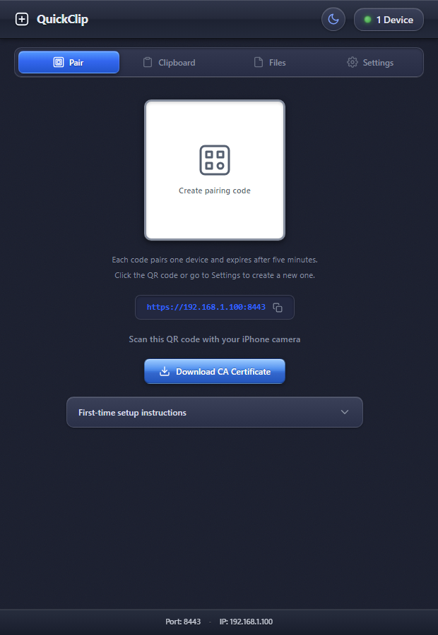
</p>
<p align="center"><sub>The compact Pair tab keeps the QR code, joining instructions, and password controls together. Pairing screenshots use an isolated test server; the pictured QR is no longer valid. Clipboard, Files, Devices, and Settings screenshots also use the isolated test browser and sample content. Certificate setup images and recordings remain physical-device references.</sub></p>

Scan the QR code after installing and trusting the certificate. With **Require password** off, the phone joins directly. To protect joining, turn it on, enter your own password, and select **Save** before scanning the new QR. The phone displays a password field and **Join QuickClip** button before receiving its device credential.

<p align="center">
  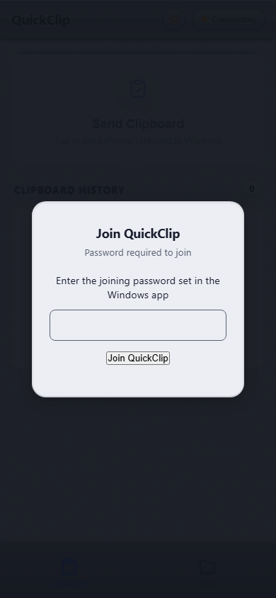
</p>
<p align="center"><sub>Phone layout captured in an isolated Chromium test window. Tap the field to open the keyboard. Incorrect passwords show an error without joining.</sub></p>

The phone stores its device credential locally and removes the invitation from the visible URL. A pending invitation survives a page refresh in the same tab. Opening a new QR link in an existing tab restarts pairing.

### Clipboard in both directions

<table>
  <tr>
    <td width="50%">
      <video src="./assets/readme/windows-to-iphone-clipboard.mp4" controls playsinline width="100%"></video>
      <p><sub>Windows to iPhone: copying the selected Notepad text adds it to QuickClip's clipboard history so it is available on the connected phone.</sub></p>
      <p><a href="./assets/readme/windows-to-iphone-clipboard.mp4">Open the Windows-to-iPhone recording</a></p>
    </td>
    <td width="50%">
      <video src="./assets/readme/iphone-to-windows-clipboard.mov" controls playsinline width="100%"></video>
      <p><sub>iPhone to Windows: QuickClip reads the clipboard after the user approves the paste action, sends it to Windows, and waits for delivery confirmation.</sub></p>
      <p><a href="./assets/readme/iphone-to-windows-clipboard.mov">Open the iPhone-to-Windows recording</a></p>
    </td>
  </tr>
</table>

> [!NOTE]
> GitHub may show the recordings as links instead of inline players. The linked files are the same demos stored in this repository.

<p align="center">
  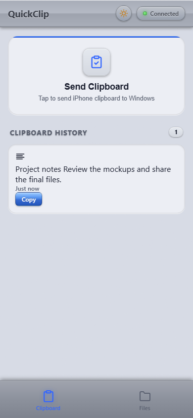
</p>
<p align="center"><sub>Current phone layout captured in Chromium with sample text. Send Clipboard sends content to Windows; Copy copies a received item.</sub></p>

<p align="center">
  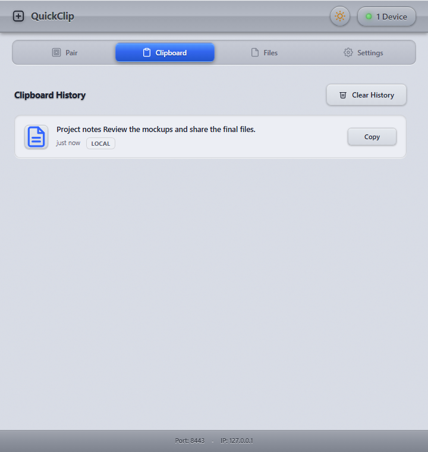
</p>
<p align="center"><sub>The current Windows clipboard view displays sample project notes. History is session-only and entries identify their source.</sub></p>

Browser clipboard access requires a user action on iOS, so the phone cannot silently monitor or replace the system clipboard in the background. Tap **Send Clipboard** or **Copy** when moving content through the phone.

### Transfer files

<p align="center">
  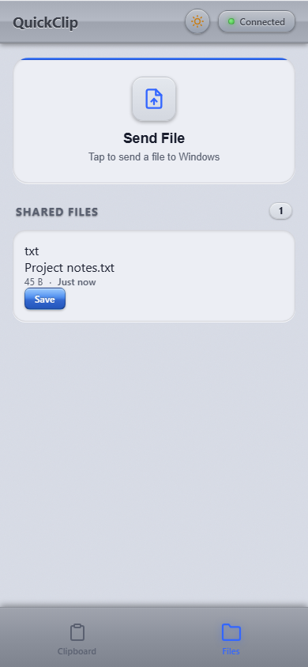
</p>
<p align="center"><sub>Current phone Files layout captured in Chromium. Send File opens the device file picker; Save downloads a shared file. On iPhone, the picker can offer Photos, the camera, Files, and other providers.</sub></p>

Files uploaded from the phone are stored under QuickClip's per-user `runtime/received` directory. Files selected on Windows are copied into the same managed directory and announced to connected phones, where **Save** requests a short-lived download link.

<p align="center">
  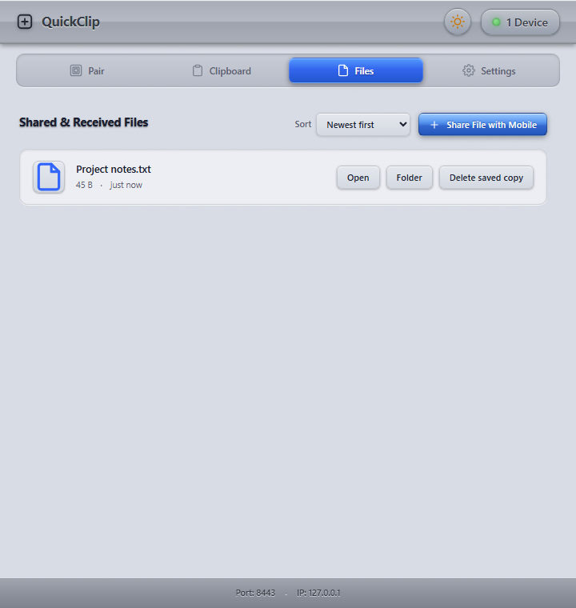
</p>
<p align="center"><sub>Sort files by newest or oldest, name A–Z or Z–A, or largest or smallest. Open a saved file, show its folder in Explorer, or delete QuickClip's copy without deleting the original.</sub></p>

### Manage devices

Click the connection badge in the top-right corner to open **Devices**. Each paired device shows its connection state and separate **Access**, **View**, and **Write** controls. The same permissions are available under **Settings > Security**.

<p align="center">
  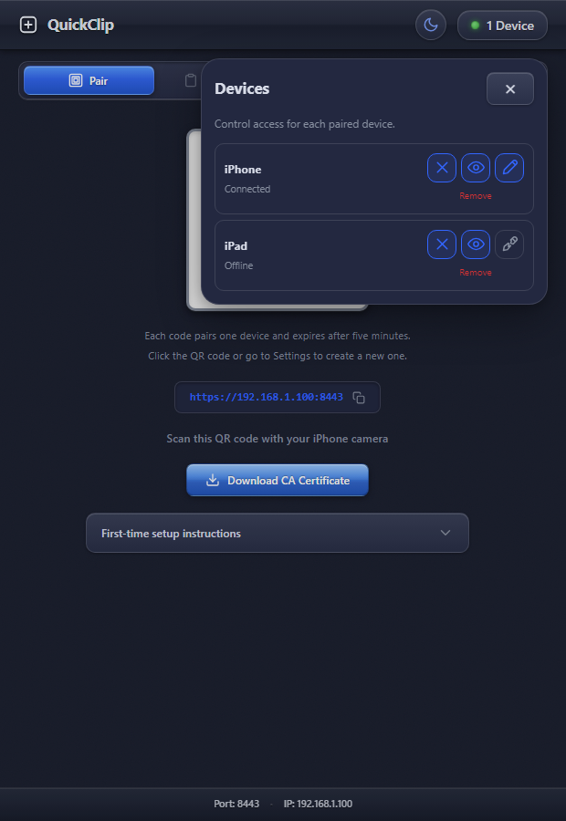
</p>
<p align="center"><sub>Allow a device to view shared content, send content to Windows, or do both. Turn off Access to block it while keeping its pairing, or choose Remove to require pairing again.</sub></p>

### Configure synchronization

<p align="center">
  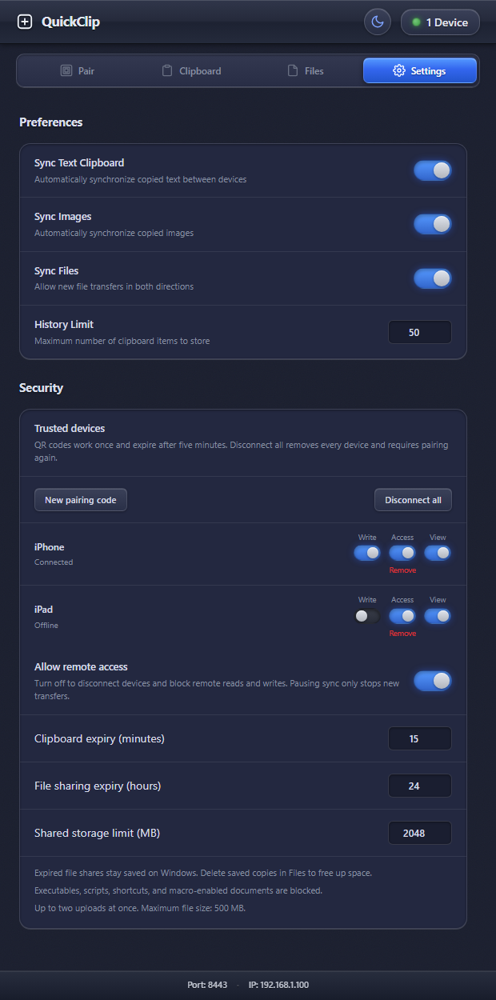
</p>
<p align="center"><sub>Settings controls text, image, and file sync; clipboard history size; trusted devices; remote access; content expiry; and shared storage capacity.</sub></p>

<details>
<summary><strong>Light and dark pairing views</strong></summary>

<table>
  <tr>
    <td width="50%"></td>
    <td width="50%">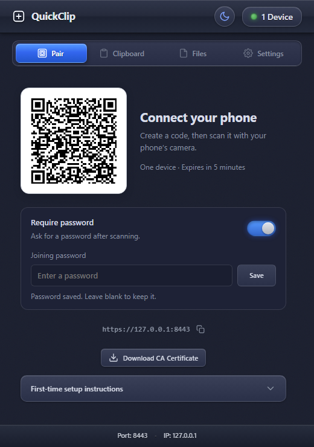</td>
  </tr>
  <tr>
    <td><sub>Light mode keeps the pairing controls and setup checklist visible against a bright desktop theme.</sub></td>
    <td><sub>Dark mode presents the same QR code, server address, and certificate workflow.</sub></td>
  </tr>
</table>

</details>

## Architecture & How It Works

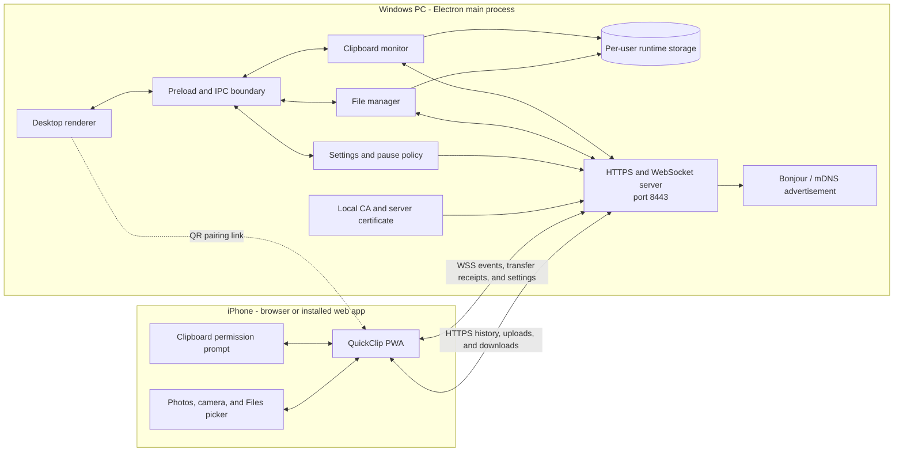

1. **Startup:** Electron migrates legacy data when needed, loads trusted-device credential hashes and settings, chooses a local IPv4 address, creates or reuses TLS certificates, and starts Express and WebSocket on port `8443`. The service is also advertised over Bonjour/mDNS.
2. **Pairing:** The desktop QR code contains the HTTPS address and a single-use invitation in the URL fragment. The phone exchanges it at `/api/pair` for a device credential, removes the fragment and uses the credential for authenticated API calls and the WebSocket handshake. Password-protected invitations require the saved joining password before issuing a credential. Windows stores only device credential hashes and a salted scrypt hash of the joining password; the password is never embedded in the QR code.
3. **Windows to iPhone clipboard:** The Windows clipboard monitor polls for changes, records accepted text or images in session history, and broadcasts a WebSocket event. Disabled image sync skips image reads. Eligible images are checked using pixel fingerprints, with PNG encoding only when pixels or dimensions change; oversized dimensions are rejected first. Text travels in the event; image history sends metadata and a thumbnail, while full-resolution image data is fetched only when the phone copies it.
4. **iPhone to Windows clipboard:** A tap on **Send Clipboard** lets the browser read text or an image. The PWA sends a transfer ID and payload over WebSocket. Windows validates the active settings and size limits, writes the system clipboard, records the item, and returns a receipt. Unconfirmed clipboard transfers can be retried for five minutes without intentionally duplicating a receipt already accepted in the current Windows session.
5. **Files:** Phone uploads use authenticated HTTPS and stream into managed temporary storage before being moved into `runtime/received`. Files chosen on Windows are copied into that directory. Connected devices receive a WebSocket availability event; downloads use file-scoped tickets that expire after 60 seconds.
6. **Settings and pause:** Desktop settings update the shared policy and are broadcast to connected phones. Disabling a content type or pausing sync blocks new transfers without deleting existing history or files.

QuickClip uses TLS between the phone and PC and does not require a cloud service. It is not an internet-facing service and should remain behind a trusted local network and firewall.

## Requirements

- Windows 10 or Windows 11, 64-bit
- Node.js 22.12 or newer
- Git, if cloning instead of downloading the repository as an archive
- A Windows PC and iPhone on the same Wi-Fi network
- A network that allows devices to communicate with each other; guest networks and AP/client isolation usually block QuickClip

## Install and run

```powershell
git clone https://github.com/shimshiam/QuickClip.git
cd QuickClip
npm install
npm start
```

For development, use `npm run dev`. This opens Electron's developer tools with the desktop app.

On first launch QuickClip:

1. Creates `%APPDATA%/quickclip/runtime` and validated settings.
2. Generates a local CA and an IP-specific server certificate under `runtime/certs`.
3. Starts the HTTPS and WebSocket server on port `8443`.
4. Starts clipboard monitoring and advertises the local HTTPS service with Bonjour/mDNS.
5. Opens the desktop dashboard, where **Create pairing code** generates a single-use QR invitation.

## One-time iPhone setup

### 1. Move the CA certificate to the iPhone

On the Windows **Pair** tab, select **Download CA Certificate**. Transfer `QuickClip-CA.crt` to your iPhone, then open it from the Files app.

<p align="center">
  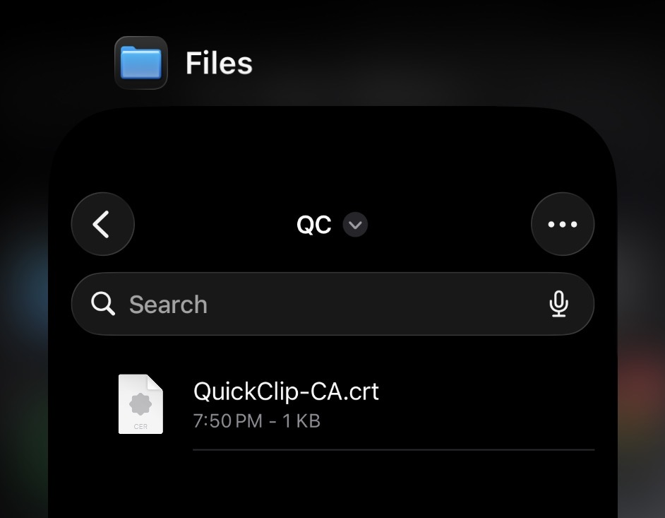
</p>
<p align="center"><sub>The QuickClip CA file is ready to be opened on the iPhone so iOS can download its configuration profile.</sub></p>

### 2. Install the configuration profile

Open **Settings > General > VPN & Device Management**, select **QuickClip**, and install the profile.

<p align="center">
  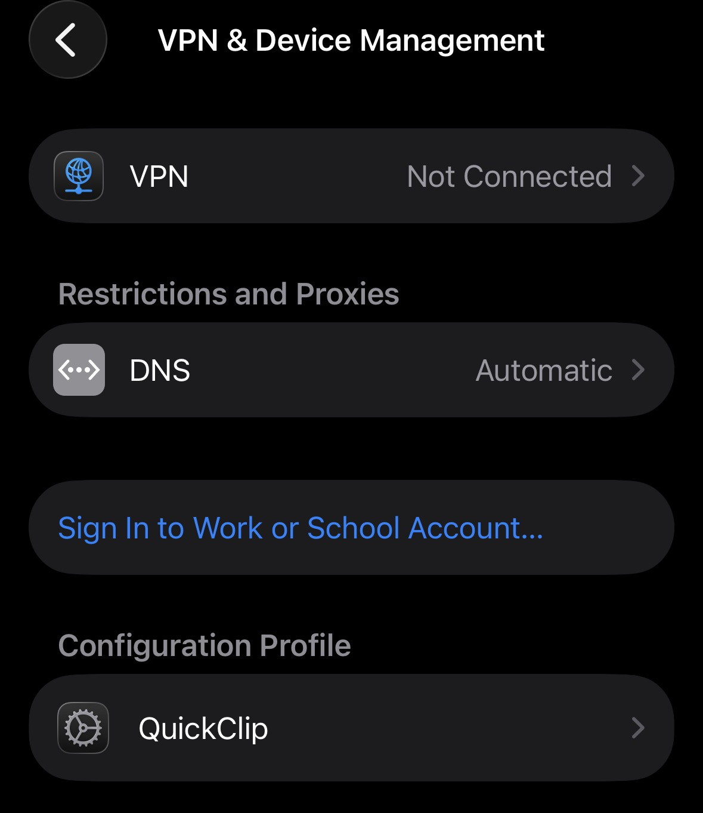
</p>
<p align="center"><sub>After the certificate file is opened, the QuickClip entry appears under Configuration Profile in VPN & Device Management.</sub></p>

### 3. Enable full trust

Open **Settings > General > About > Certificate Trust Settings**. Under **Enable Full Trust for Root Certificates**, turn on **QuickClip** and confirm.

<p align="center">
  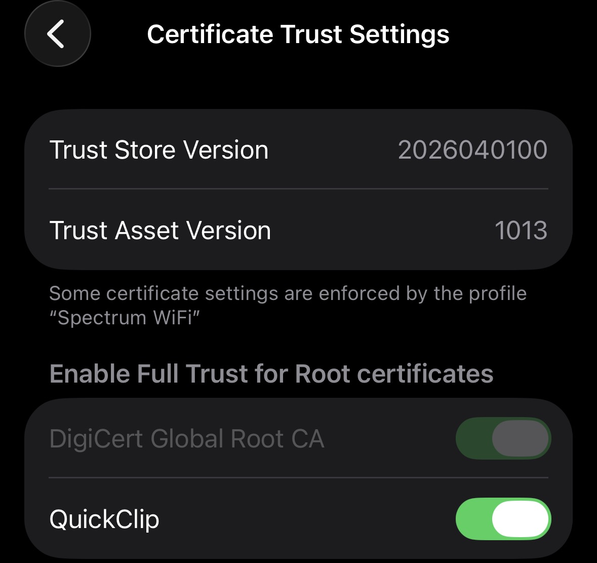
</p>
<p align="center"><sub>Full trust allows iOS to validate QuickClip's local HTTPS page and secure WebSocket connection.</sub></p>

### 4. Scan and connect

Return to the Windows **Pair** tab. Leave **Require password** off for QR-only joining, or turn it on, enter a password, and select **Save**. Select **Create pairing code** if no code is displayed, then scan it with the iPhone camera within five minutes. If prompted, enter the password you saved on Windows and tap **Join QuickClip**. Wait for **Connected**. In Safari, use **Share > Add to Home Screen** if you want QuickClip to launch like an app.

> [!TIP]
> If **Connecting...** persistently remains on screen in Safari after the certificate is installed and trusted, open the pairing link in **Chrome on the iPhone** instead.

<details>
<summary><strong>Why Windows may call the CA certificate untrusted</strong></summary>

<p align="center">
  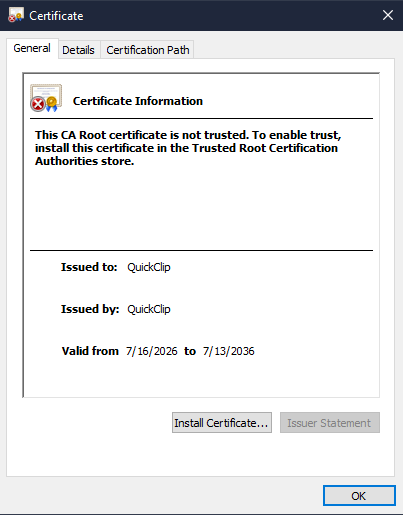
</p>
<p align="center"><sub>Double-clicking the downloaded CA on Windows can show this message because the CA is not installed in the Windows Trusted Root store. QuickClip's iPhone setup only requires transferring this file and trusting it on iOS; this Windows dialog is not the iPhone trust step.</sub></p>

</details>

## Configuration and storage

QuickClip stores runtime data in `app.getPath('userData')/runtime`, normally `%APPDATA%/quickclip/runtime` on Windows.

| Path | Purpose |
| --- | --- |
| `runtime/config.json` | Validated synchronization and security settings; legacy tokens are ignored |
| `runtime/devices.json` | Trusted device names, IDs, permissions, and credential hashes |
| `runtime/certs/` | Local CA, server certificate, private keys, and the last certificate IP |
| `runtime/received/` | Files transferred in either direction |
| `runtime/received/index.json` | Metadata and managed local paths for shared files |
| `runtime/clipboard-images/` | Full-resolution images for the current clipboard-history session |
| `runtime/tmp/` | Temporary storage used while phone uploads are in progress |

When migrating from the older project-level `data/` directory, QuickClip copies and verifies the data before activating the new location. The original directory is retained as a recovery copy. Clipboard history is session-only; associated image files are removed as entries expire, history is cleared, or the app exits. Received files persist.

At startup, QuickClip renews the server certificate if it expires within 30 days, has already expired, or the selected IP has changed. It keeps the existing CA certificate and key, so routine renewal does not require reinstalling the iPhone profile. Startup also checks the certificate signature, IP address, and matching private key, and refuses invalid or incomplete CA material instead of silently replacing the trusted CA. Certificate storage permissions are restricted before keys are read or generated. Renewal checks run at startup; they do not restore trust if iOS has disabled the installed profile.

### Pairing, privacy and storage controls

In the Windows Pair tab, select **Create pairing code**, or select **New pairing code** in Settings, then scan it within five minutes. Each code works once; generating another invalidates the previous code. Up to 20 devices can be trusted. **Remove** revokes one device's credential. **Disconnect all** removes all trusted devices and invalidates the current invitation. These actions close connections and invalidate the affected download links and active requests.

**Joining password:** choose 1–128 characters, including letters, spaces, and symbols. The preference and password hash persist across restarts. Leave the password field blank to keep the saved password, or enter a replacement and select **Save**. Saving a new password or changing the requirement invalidates the previous QR and creates a fresh one. Five incorrect attempts invalidate an invitation; create another code to try again.

**Changing a password with connected devices:** selecting **Save** opens a compact device review before anything changes. The list includes connected and offline trusted devices.

<p align="center">
  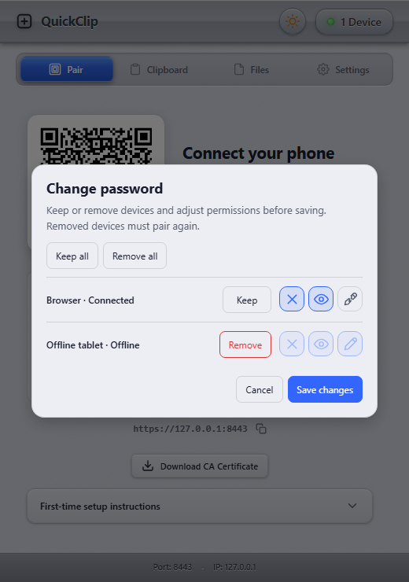
</p>
<p align="center"><sub>Isolated test capture: keep the connected browser with Write off and remove the offline tablet. Choices take effect only after Save changes. The background QR is no longer valid.</sub></p>

- Choose **Keep all** or **Remove all**, or toggle **Keep / Remove** for individual devices.
- Adjust **Access**, **View**, and **Write** using the same icon buttons as the Devices drawer. Hover for the permission name and current state. Controls also have accessible labels; permissions are disabled for devices marked for removal, and View/Write controls are disabled when Access is off.
- Select **Save changes** to apply the password and device choices. Removed devices must pair again; kept devices retain their credentials with the selected permissions. **Cancel** leaves everything unchanged.

If the device list or permissions change during review, cancel and reopen it. Without connected devices, changing the password keeps trusted devices; use **Remove** or **Disconnect all** to revoke them.

Each paired device has three permissions, saved across app restarts:

| Permission | When enabled | When disabled |
| --- | --- | --- |
| **Access (A)** | Allows the device to connect, subject to its View and Write permissions | Blocks remote reads and writes without removing the pairing; View and Write choices are preserved |
| **View (V)** | Allows clipboard history, shared-file lists, downloads, and live content updates | Blocks those reads and updates; Write can remain enabled |
| **Write (W)** | Allows clipboard submissions and file uploads to Windows, subject to sync settings | Blocks submissions and uploads; View can remain enabled |

View and Write changes take effect on the existing connection. Turning off View clears the phone's displayed history, cancels reads, and invalidates download links while leaving permitted uploads running. Turning off Write cancels uploads and pending clipboard images while leaving permitted downloads running. Access off disconnects the device and cancels all its requests; the phone retries while waiting for Access to be enabled. Turning off a permission cannot recall content already copied or downloaded.

**Allow remote access** blocks all remote reads, writes and pairing when switched off, while retaining trusted devices for later use. The phone retries after it is enabled. **Pause sync** only stops new transfers; it leaves existing shared content accessible.

Clipboard history expires after **15 minutes** by default, including while sync is paused. File shares expire after **24 hours** by default; saved Windows copies and original source files remain intact. Settings allows 1–1440 minutes for clipboard history and 1–720 hours for file shares. File age is measured from when it was shared; changing the file lifetime recalculates availability for retained files. Previously downloaded or copied content cannot be recalled from another device.

Shared files and partial uploads have a **2048 MB** default quota, configurable from 500 to 102400 MB. QuickClip reserves capacity for pending writes, limits uploads to two at once, and keeps at least 256 MB of disk space free. Expired shares still occupy disk space. Use **Delete saved copy** in Files to reclaim it; original source files are unaffected.

Executables, scripts, shortcuts, disk images and macro-enabled Office files are blocked when shared and when opened through QuickClip, including older saved files. This extension-based safeguard is not malware scanning and does not inspect archive contents.

### Limits and delivery behavior

- Text clipboard payload: up to 1 MiB of UTF-8 data.
- Clipboard image: PNG or JPEG, up to 20 MiB compressed and after PNG conversion, and up to 40 megapixels.
- File upload: one file per request, up to 500 MiB, with at most two simultaneous uploads.
- Clipboard history: 1 to 200 items, with 50 as the default.
- Clipboard delivery confirmation: 15-second confirmation window and a five-minute retry window.
- Download tickets: scoped to one file or image and valid for 60 seconds.

The text and image limits can be lowered with `maxTextBytes` and `maxImageBytes` in `runtime/config.json` while QuickClip is closed. Large images can be sent as ordinary files. If a phone upload is interrupted by backgrounding or the ten-minute upload timeout, check Windows before retrying because file uploads do not use clipboard-style receipt deduplication.

### Network interface selection

QuickClip prefers private LAN addresses on likely Ethernet or Wi-Fi adapters over known virtual adapters, VPNs, shared VPN address ranges, and link-local addresses. This is a heuristic; adapter names cannot prove which network your iPhone can reach.

To override it, right-click the QuickClip tray icon and open **Network Interface**. Choose the adapter and address on the iPhone's network, or choose **Automatic** to clear the override. Finish transfers first: changing this setting saves the choice and restarts QuickClip, clearing session clipboard history. Re-scan the new QR code after the restart. The existing CA is retained.

The saved choice follows that adapter's current address at startup, including DHCP changes. If the adapter is unavailable, QuickClip falls back to automatic selection and marks the saved choice as unavailable in the tray menu. Network changes during a running session still require restarting QuickClip.

## Troubleshooting

<details>
<summary><strong>The iPhone stays on "Connecting..."</strong></summary>

- Confirm that the Windows PC and iPhone are on the same Wi-Fi network.
- Avoid guest Wi-Fi, AP isolation, or client isolation.
- Confirm that the QuickClip profile is both installed and enabled under **Certificate Trust Settings**.
- Allow Electron/QuickClip on Windows **Private networks**. QuickClip uses TCP port `8443`; Bonjour/mDNS uses UDP port `5353`.
- Re-scan the QR code after the PC's local IP address changes.
- If Safari continues to show **Connecting...**, use **Chrome on the iPhone** to open the pairing link.

</details>

<details>
<summary><strong>The browser reports a private or untrusted connection</strong></summary>

Installing the profile and enabling full trust are separate iOS steps. Verify both **Settings > General > VPN & Device Management > QuickClip** and **Settings > General > About > Certificate Trust Settings > QuickClip**.

</details>

<details>
<summary><strong>The PC's local IP address changed</strong></summary>

QuickClip checks the local IPv4 address at startup. When it changes, QuickClip creates a new server certificate signed by the existing CA. Restart QuickClip and re-scan the QR code; the CA normally does not need to be installed again.

</details>

<details>
<summary><strong>A transfer is disabled or remains unconfirmed</strong></summary>

Check the Windows Settings tab and the tray's pause state. Clipboard sends wait for a receipt from Windows; reconnect and use **Retry** within five minutes if delivery was not confirmed. For an interrupted file upload, check the Windows Files tab before sending it again.

</details>

### Transfer recovery

Interrupted or malformed uploads are rejected and temporary files are cleaned up; startup also removes generated upload files left by a crash. If the file index cannot be saved, unpublished managed copies are removed. If deletion fails, the file stays listed so it can be retried. Interrupted uploads must be restarted.

The phone clears remote history after disconnects or denied reads. Delayed responses cannot restore content after permission loss or overwrite a newer refresh.

### Password prompt troubleshooting

If the keyboard appears without a visible password field on an older build, update QuickClip and reload the phone page. The current interface shows the connection overlay until joining succeeds and opens the keyboard only when the field is tapped. Scan a fresh QR if the invitation expired, was replaced, or reached its retry limit. An already trusted device reconnecting without a new invitation does not need to enter the joining password again.

## Verification

```powershell
npm test
npm run test:electron
```

`npm test` currently passes 56 tests covering transport, validation, settings persistence, password verification and retry limits, device-review validation and failed-save rollback, certificate validation, permission changes, upload cleanup, migration, and history storage. `npm run test:electron` runs an isolated Electron check for clipboard decoding, the desktop and phone interfaces, confirmed transfers, pause/resume, history reload, custom-password joining, existing-tab QR navigation, a visible, clickable password field, and device-review cancellation, selection, and permission icons. This is a Chromium check, not a substitute for testing on a physical iPhone. Test screenshots are written to `.test-output/`.

For final device verification, send text and an image in both directions, copy a history image after reloading the phone page, upload and download a file, and reconnect after locking the phone.

## License

Distributed under the MIT License, as declared in `package.json`.
